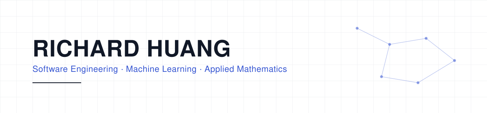

<picture>
  <source media="(prefers-color-scheme: dark)" srcset="assets/header-dark.svg">
  <source media="(prefers-color-scheme: light)" srcset="assets/header-light.svg">
  
</picture>

I build software, from CLI tools and algorithmic visualizers to browser games, and study Applied Mathematics at UT Austin. My recent work is in optimization, model efficiency, and evaluation pipelines.

## Selected work

**Pixling** (HackTX 2026)
*JavaScript · HTML5 Canvas · Web Audio API · Node.js · Gemini API · Vercel*
A mobile-first 16-bit pixel pet game, built by a team of 4 in 24 hours, where your pet only grows when you complete real-world quests at real places near you. Quests come from live Google Maps data, you prove them with a photo, and Gemini judges the proof (blank and reused photos are rejected locally before any model call). I built the per-animal theming system that replaced 5 shared class themes, so each animal gets its own icons, habitat and palette that change across four times of day; the evolution visuals; three Austin legendary animals; and per-species pet, happy and hatch sounds synthesized from each animal's cry with the Web Audio API.
[Repository](https://github.com/KernyMC/pixling-hacktx26/tree/systems)

**Guitar Tab Fingering Optimizer**
*Python · optimization · runnable program*
Reads a plain-text guitar tab, computes the least effortful fingering for the whole song, and animates it on a fretboard. The pipeline (parser, moment grouping, rhythm estimation, optimizer, visualizer) treats fingering choice as a shortest-path problem over a layered graph, the same structure as the Viterbi algorithm, solved with dynamic programming over hand-shape costs (stretch, hand shift, finger preference). The costs are calibrated against real fret spacing, so a two-fret stretch high on the neck isn't priced the same as one near the nut.
[Repository](https://github.com/RH00000/guitar_tab_fingering_optimizer)

**LLM Replicability Evaluation**
*Python · prompt engineering · evaluation*
An evaluation pipeline testing whether Gemini 2.5 Pro/Flash can predict which psychology studies replicate, using the Reproducibility Project: Psychology dataset. I iterated on several prompt designs, ensembled predictions across prompt variants, and recalibrated confidence across multiple trials.
[Repository](https://github.com/RH00000/Rice_LLM_Replicability_Project)

**Confidence-Based ResNet Cascades**
*Python · PyTorch/TensorFlow · inference efficiency*
Dynamic-skipping ResNet cascades that stop early on inputs the model is already confident about, benchmarked on ImageNetV2 across cascade depths and confidence thresholds to map the accuracy/latency tradeoff on GPU. Built with the University of Houston Real-Time Systems Group; related work was submitted to IEEE RTSS.
[Repository](https://github.com/RH00000/UH_RTS_Research_ML)

## Tools

**Languages**
Python · TypeScript · JavaScript · Java · SQL · HTML/CSS

**Web & Software**
React · Node.js · Git · GitHub Actions · Linux · CUDA

**ML / Data**
PyTorch · TensorFlow · scikit-learn · NumPy · Pandas · Matplotlib · NetworkX
